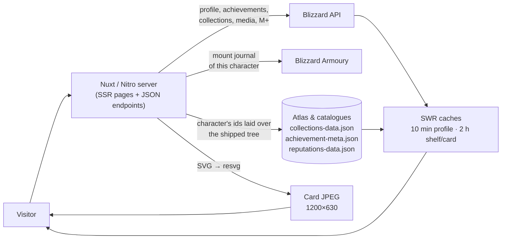

<div align="center">


# ⚔️ Hero of Azeroth

**Everything a World of Warcraft character is — on one page, and in one image.**

Item level · M+ score · achievements · mounts · pets · toys · decor · reputations

[](https://nuxt.com)
[](https://nodejs.org)
[](https://develop.battle.net)
[](#-bilingual)
[](#-disclaimer)

[🌐 heroofazeroth.com](https://heroofazeroth.com) · 🇬🇧 English · 🇷🇺 Русский · 🌍 EU & US realms

<a href="https://heroofazeroth.com"></a>

</div>

---

## ✨ What it does

- 🎴 **Character cards** — a profile rendered as a 1200×630 image. Every page carries its own card as
  its link preview, and the header hands you the file to download or the link to copy.
- 🔎 **Look up anyone** — EU and US realms, realm autocomplete, a search history that remembers what
  you looked at, and addresses that are stable enough to share.
- 🏅 **Overview tab** — item level, M+ score, achievement points against what is reachable, mounts,
  pets, toys, decor and reputations, each tile marked `account-wide` or `per character`.
- 🐎 **Collection shelves** — mounts, pets, toys and decor drawn against the **whole game**: every
  expansion and event bucket with its own bar, every source ("Raid Drop", "Vendor", a zone) as a block
  of tiles beside its neighbours, and a rail of anchors to jump between them.
- 🧭 **Numbers that mean something** — a shelf counts what the character can *still get*
  (SimpleArmory's own numbers), and two switches uncover what it cannot: the retired items and the ones
  the game has not shipped yet. A short note under the bar says where every number comes from.
- 📜 **Activity feed** — the hundred achievements a character earned most recently, with icons and
  filters for all / achievements / PvE / collections / PvP.
- 🏆 **Achievements & reputations** — reputations counted the way the game counts them (an Exalted faction, the
  last renown level, the highest companion rank), and as the account's own union of finished factions across the
  roster, the number the journal and the tile both print, with this character's own ladders beside it.
- 🌍 **Bilingual** — English at the plain address, Russian under `/ru`: pages, SEO alternates, the
  card image, and the collection headings themselves.
- ⚡ **Built to be fast** — Blizzard is read once per character and answered from a stale-while-
  revalidate cache; the game's whole catalogue (collections tree, achievement wording, faction
  ladders) is paid for offline and shipped with the build.
- 🎨 **A look of its own** — dark fantasy theme, the character's own Armoury artwork, Wowhead tooltips
  on hover, mobile-first layout.

---

## 🖼 A real card — live, not a screenshot

<div align="center">

<a href="https://heroofazeroth.com/ru/region-eu/gordunni/%D0%BD%D0%B5%D0%B9%D1%80%D0%BE%D0%BC%D0%B0%D1%81%D0%BA">

</a>

<sub>The picture above is drawn on demand by <code>/api/card/…</code> and served as a JPEG — 1200×630,
the size a social network wants, with the character's own render and class artwork in it.</sub>

</div>

### The pages behind it

| Address | What it shows |
| --- | --- |
| `/` | Front door *and* hall of fame: the ranking of every character the site has looked up — sorted, filtered and searched — with the search itself in the header bar (region, realm autocomplete, character name, recent searches) while this browser knows no character and nobody is signed in |
| `/region-eu/<realm>/<name>` | Overview: the stat tiles, the render, download / share / refresh |
| `/region-eu/<realm>/<name>/collections` | Collections summary: a tile per shelf and the running total |
| `/region-eu/<realm>/<name>/collections/mounts` | A shelf: sections with bars, sources side by side, the three switches, the note |
| `/region-eu/<realm>/<name>/achievements` | Achievements summary: a tile per category and the running total |
| `/region-eu/<realm>/<name>/achievements/dungeons` | One achievement category: sections with bars, subcategories side by side, the tile grid |
| `/region-eu/<realm>/<name>/activity` | The achievement feed with its category filters |
| `/ru/…` | The very same pages in Russian |

The hall of fame's old address, `/leaderboard`, is a 301 to `/` (`nuxt.config.ts`, `routeRules`): the two are one
page now, and only the address that no longer names anything redirects - every other page of the site still
refuses to.

## 🚀 Quick start

```bash
npm install
```

Create a `.env` with a Blizzard API client
([Creator portal](https://develop.battle.net/access/clients) → client credentials):

```bash
NUXT_BLIZZARD_CLIENT_ID=...
NUXT_BLIZZARD_CLIENT_SECRET=...
```

Then:

```bash
npm run dev       # development server on http://localhost:3100
npm run build     # production build into .output
npm run preview   # run the built server locally
npm run deploy    # build, push the sources, upload the build to the host (see Deploying)
```

The development port is **pinned to 3100**, and it is not a preference. `nuxt dev` resolves its port
as `--port`, then `NUXT_PORT`, then `NITRO_PORT`, then `PORT`, and only then `devServer.port` - and it
reads those variables before `nuxt.config.ts` is loaded, so a stray `PORT` inherited from another
project or an editor would quietly move the dev server elsewhere. Both scripts therefore pass the
port on the command line (`nuxt dev --port 3100`), which nothing else can override, and
`npm run dev` first checks the port is free (`scripts/check-dev-port.mjs`) so a second dev server
fails with a message that names the cause instead of drifting to another port - which would leave the
Battle.net callback, registered against `http://localhost:3100/api/auth/callback`, refused on the
way back.

---

## 🧩 How it works

A page is rendered on the server, so the first response already carries the data — no spinner before
the content. Three kinds of things meet in the process:

- **Live reads.** A character's profile, achievements, collection lists, media and M+ score come from
  Blizzard's profile API, once per character, and the next visitor is answered from a
  stale-while-revalidate cache (ten minutes for a profile, two hours for a shelf or a card) — a burst
  of traffic pays for one lookup.
- **Shipped catalogues.** Everything the game *contains* is paid for offline and compiled into the
  build: the collections atlas, the achievement catalogue, the faction ladders and the total
  fallbacks. None of it is read per request.
- **The card.** `/api/card/…` composes the very icons the page draws into an SVG and rasterises it
  with resvg into a JPEG. That file is what a link preview shows.



### How numbers are written

Every figure on the site — and every figure drawn into the card — is written one way: thousands
grouped by a space, never by a comma and never run together. `1 200` mounts, `44 720` achievement
points, `2 997` M+.

That is not a per-page decision, and it is not `toLocaleString`. The rule lives in exactly one place,
[`shared/utils/formatNumber.ts`](shared/utils/formatNumber.ts), and both ends of the project call it:
the Vue pages and the `resvg` card renderer. It is not the language's own separator on purpose — a
comma in English, a non-breaking space in Russian — because the card is drawn by resvg in a font the
site ships, where a glyph a face does not carry is a box, and because a count has to read the same in
the picture as on the page it previews. A figure that must stay on one line is kept whole with
`whitespace-nowrap` where it stands: a layout decision, not a formatting one.

**A figure printed without it is the bug.** Add the `formatNumber` call rather than a local helper —
a second implementation is a second answer.

### Endpoints

| Endpoint | Answers |
| --- | --- |
| `/api/character/<region>/<realm>/<name>` | The entire profile the overview draws (`?force=true` re-reads Blizzard) |
| `/api/collections/<region>/<realm>/<name>?kind=mounts` | One shelf, laid over the character's ids — `kind` is `mounts`, `pets`, `toys` or `decors`, and `?unobtainable=1` / `?upcoming=1` are the two switches; without `kind` it answers the summary |
| `/api/achievements/<region>/<realm>/<name>` | The achievements summary, laid over the character's log (omit `?category=` for the summary, add it for one category's shelf) |
| `/api/reputations/<region>/<realm>/<name>` | The character's own reputation journal, laid over the shipped faction tree — this character only, never the account's union (see below) |
| `/api/user/heartbeat` (POST) | The presence beat of a signed-in reader: one a minute from an open, visible tab, which is what puts that account's main on the hall of fame's online dots |
| `/api/leaderboard/presence` | Who is on the site right now, as the keys of the mains whose account has beaten inside five minutes |
| `/api/activity/<region>/<realm>/<name>` | The recent-achievement feed |
| `/api/card/<region>/<realm>/<name>?locale=ru_RU` | The shareable JPEG, 1200×630 |
| `/api/realms` | The realm list the search box completes from |
| `/sitemap.xml` | Every character the site has rendered, with its language alternates |
| `/api/leaderboard?sort=mounts&faction=horde&realm=…&class=…&q=…&page=1` | One page of the hall of fame together with the community's totals — cached for an hour |

## 🗂 Project map

| Where | What lives there |
| --- | --- |
| `app/pages/index.vue` | The front door, which is the hall of fame: the search block above the table |
| `app/pages/privacy.vue` | The privacy policy: what is collected, what a sign-in stores, and what the counters are |
| `app/pages/about.vue` | About the site: what it is, the four things it does, and the fact that it is free |
| `app/pages/legal.vue` | The legal and trademark notice: whose game this is, and whose site this is not |
| `app/pages/[region]/[realm]/[name].vue` | The character shell: header, tabs, share / download, refresh |
| `app/pages/[region]/[realm]/[name]/` | The tabs themselves: `index` (overview), `collections/*`, `achievements/*`, `reputations`, `activity` |
| `app/components/` | `CollectionsGrid`, `CollectionShelf`, `CollectionScopeSwitch` (whose collection the figures are: this character's or the whole account's, on a shelf and on the summary), `CollectionMenu`, `AchievementSummaryGrid`, `AchievementShelfGrid`, `AchievementShelf`, `AchievementMenu`, `ReputationShelf`, `ReputationRow`, `ActivityFeed`, `CharacterName`, `WowheadLink`, `AppIcon`, `LocaleSwitch`, `ScopeSwitch` (the pair of chips a scope question is asked with, on the collections pages and on the reputation journal), `SiteBackdrop` (the artwork, scrim and vignette every page stands on), `SiteHeader` (the brand, the page's name and the row of tabs), `SiteFooter`, `SiteDocument` (the frame the about page, the policy and the legal notice are cut from), `DocumentNav` (the rail of those documents, beside them), `ProfileStatsNote` (what the account page's figures are and where they come from, folded behind its own title), `ScoreLegend` (the multipliers the site's score is made of, beside the gold figure and at the end of the hall of fame's filter row), `CookieNotice` (the cookie question, and the way back to it), `SupportButton`, `BackToTop`, `MyProfile` (who this browser is signed in as), `CharacterSearchForm` (the two fields that look a character up), `CharacterSearchDialog` (the same two fields, opened from a page's own row) |
| `app/components/leaderboard/` | `LeaderboardStats` (the widgets), `LeaderboardFilters` (columns, chips, search, the realm menu), `LeaderboardTable`, `LeaderboardYou` (the reader's own place in the table) |
| `app/composables/` | `characterView`, `collections`, `collectionView` (the switches a shelf carries: what is shown, and whose collection), `reputationView` (whose journal a page reads: the character's or the account's), `achievements`, `achievementView`, `reputations`, `presence` (the beat and who is on the site), `cookieConsent` (the reader's answer and the Consent Mode call it makes), `characterLookup` (the ask that opens the search from outside it), `leaderboardView`, `realmNames`, `lang`, `seo`, `searchHistory`, `urls`, `relativeTime`, `wowheadPower` |
| `server/api/` | The endpoints above |
| `server/utils/` | Blizzard client, the atlas and its readers, the card renderer, the SWR cache, reputations, achievements, the Armoury reader, the character index, `leaderboardStorage` |
| `scripts/` | The offline refreshes (see below) and `deploy.mjs` |
| `shared/data/collectionsSchema.ts` | The collection types, the section shape, and the Russian label map |
| `shared/data/reputationsSchema.ts` | The reputation journal's types, the stage message keys, and the synthetic group's name |
| `shared/data/leaderboardSchema.ts` | The hall of fame's record, query and payload types, shared by the server and the components |
| `shared/utils/leaderboardScore.ts` | `calculatePlayerScore` and the weights it is made of |
| `shared/utils/consent.ts` | The cookie key, the Consent Mode defaults and what an answer changes — read by both `nuxt.config.ts` and the banner |
| `shared/utils/wow-{class,faction,professions}.ts` | The names the game's own UI uses, in both languages: the classes, the factions, and the professions (taken from Blizzard's profession index, so a pill reads as the game's profession pane spells it) |

---

## 🏆 The hall of fame

The site's front door *is* its hall of fame: `/` is a public ranking of every character the site has ever
rendered — the same population the sitemap is built from — with the search on top of it and the community's own
totals between the two. It is built so that opening it costs the rest of the site nothing:

- **Nothing is aggregated per request.** One file, `server/data/leaderboard.json`, holds a record per
  character, and the overall rating is computed when a profile is *written* rather than when the table
  is read — so a reader costs the same whether the table holds ten players or ten thousand.
- **A read is a filter and a sort over memory.** The file is parsed once per process and kept in a
  snapshot; a write replaces the snapshot and clears the memoised statistics.
- **The endpoint is cached for an hour** (`defineCachedEventHandler`, `maxAge: 3600`, `swr: true`), so
  a burst of readers is answered from Nitro's memory in single-digit milliseconds and the hour is
  refreshed *behind* a response rather than in front of one. The first page of the table is rendered
  on the server and arrives inside the document.
- **A write is queued and atomic.** Records are appended through one promise chain, and the document
  is written to a temporary name and renamed over the target: two lookups landing together cannot lose
  each other, and a process killed mid-write leaves the previous file intact.
- **It is fed by the pages themselves.** Every character page a reader opens hands the table that
  character's figures — from the profile cache or from Blizzard, it makes no difference — so a record
  the sitemap's thinner index could only half write fills in the first time somebody looks that
  character up. A record that already says everything the profile does is not written again, which is
  what keeps a reader from costing the disk anything at all.

The storage sits behind `server/utils/leaderboardStorage.ts`, and that module is the only thing that
knows the data is a JSON file — `getLeaderboard`, `upsertPlayer` and `getGlobalStats` are the whole
contract, so moving it to SQLite (`better-sqlite3`, `db0`) is a rewrite of that one file and a change
to nothing else: not the endpoint, not a component. A table that has never been written is filled from
the sitemap's own index on the first read, so the page opens with the site's history in it rather than
empty; a figure the index never kept — pets, toys, decor, achievement points, faction — appears the
next time that character is looked up.

The weights are one line per category in `shared/utils/leaderboardScore.ts` (`SCORE_WEIGHTS`), each
chosen so that a top-end character contributes the same order of magnitude to every one of them.
Adding transmog or reputations is a line there plus a field in the record; the endpoint, the page and
the components do not have to learn about it.

On the page itself the figures are the reader's to choose: a row of chips switches columns on and off —
the overall chip means every column, and picking any other one shows exactly the figures it names,
several at once — and a `?` beside them opens the legend of the score, whose multipliers are read off
the formula itself so the panel cannot promise something the server does not compute. The realm names
come from the site's realm list rather than from whichever language the record happened to be written
in, and an item level is printed only for a character at the current level cap, a figure that says
nothing among characters still climbing.

The page carries the site's one search in three places, and every one of them is the same two fields
(`app/components/CharacterSearchForm.vue`) - the site's own glass, with the rim of a field warming to the brand
gold while it holds the cursor: in the header bar, as one row, while this browser knows no character and nobody is
signed in (`compact` - the shape the front door wears on a first visit); the sheet the row drops
(`app/components/CharacterSearchDialog.vue`, on `Ctrl`/`⌘`+`K` as well); and the button under an empty table -
because a name the table does not hold is not a name the site does not know, it is one nobody has looked up yet,
and looking somebody up is what writes their row. That last one asks for the search instead of holding it
(`app/composables/characterLookup.ts`) and hands over the name the reader typed into the filter, so the field is
not a dead end.

The character the page is *about* is the one this browser opened last, or - for a reader who is signed in and has
looked nobody up on this device - the main of their account: `/api/profile` is read for the row's own badge in any
case, so the main costs the page no second request, and a reader who signed in somewhere else finds their
character waiting in the bar instead of a pair of empty fields. The row under the page's name carries that
character's own views - profile, collections, achievements, reputations, feed - and draws them only once there is
one; the bar carries their place in place of the account chip
(`app/components/leaderboard/LeaderboardYou.vue`).

## 🎯 Collections: where the numbers come from

Every mount, pet, toy and decoration in the game, in SimpleArmory's own tree: a bucket per expansion or
event, the sources under it ("Raid Drop", "Vendor", a zone), the items under those. The server lays the
character's own ids over that tree, so a shelf looks the same for everybody and the counts belong to
the character.

Two rules make a shelf read **lower** than the counter in the game — and truer for it:

- 🚫 **Retired items are hidden.** An item the game has done away with is drawn only for a character
  who already holds it: a rarity to show off rather than a goal to chase. It is left out of the count
  too, which is what keeps a 1,300-item shelf from reading 1,404.
- ⏳ **Unreleased items wait.** The Trading Post's coming stock and the mounts of a patch that is not
  live are not drawn at all.

Both are SimpleArmory's own settings, and both are yours as well — the two switches under the shelf's
bar, with a note beside them that says the same:

| Switch | What it uncovers |
| --- | --- |
| **Unobtainable** | Every retired item the site knows, drawn as a grey tile. Items that were never released stay hidden, exactly as they do there |
| **Upcoming** | The handful of items Blizzard has in the files but has not shipped |

With a switch on, a shelf reads exactly what SimpleArmory reads with its own setting on — the numbers
were matched item by item, not approximated.

### By account or by character

A WoW collection is shared by every character of a Battle.net account, so the account is the truer unit for a
collector — and a reader who is signed in finds one more choice in that same row: **per character** (where a
shelf opens, and all a guest ever gets) or **account-wide**, which draws the shelf from the account's own ids.

Those ids are Blizzard's account-wide collections, read with the reader's own token and kept in the site's pool
(`server/utils/accountPool`), so the choice is honoured for the account that holds the character and for nobody
else: a link copied out of a signed-in browser opens the character's own shelf for whoever it reaches, and a
guest is not even offered the switch. The account's shelf is also the one drawn without the faction filter — an
account plays both sides, so nothing it holds is out of its reach — and it says which reading it gave you: a
collection the site has never read for that account (Blizzard refuses the account's decorations today) falls back
to the character's journal and says so in a line under the switches. The four tiles of the collections page
follow the same choice, with the line under the running total naming whose numbers they are.

### Why they differ from the game's own counter

They are meant to: the sources count different sets, and every one of them is right.

| Source | Reads | What it counts |
| --- | --- | --- |
| **In game · Wowhead tracker** | `1215 / 1334` | Everything the character has learned, over the journal the client shows for its faction |
| **Blizzard Armoury** | `1215 / 1387` | The same list, over the Armoury's own journal size — a number that belongs to the character and moves with the patch |
| **Blizzard API** | `1215` learned · `1117` usable | The raw list, ~98 of them unusable mounts of the other faction |
| **Hero of Azeroth — a shelf** | `1163 / 1302` | What this character can still get: SimpleArmory's numbers, to the item |
| **dataforazeroth** | `1162 / 1303` | Their own list, keyed by id rather than by row |

*(one Alliance character, patch 12.1.0 — the absolute numbers move with every patch, the reasons do not)*

The stubborn ±1 against other sites is data, not arithmetic: SimpleArmory counts the **rows** of its own
file, and one mount in it (`Deathtusk Felboar`) sits twice under the same source — a character who owns
it reads one higher there than on any site that keys by id. This project reproduces its rows, because
the tree is its tree.

---

## 🎖 Reputations: the journal of one character

`/…/reputations` is the faction journal of the character whose page is open — the tab beside Collections
and Achievements. It is drawn from `server/utils/reputations-data.json`, the atlas
`npm run refresh:reputations` builds: Blizzard's own reputation-faction tree (the expansions, the headings
under them — a side, a garrison, a cluster of city factions — and the factions in those), the side that may
raise each one, and the steps of every ladder (the classic eight, a renown faction's levels, a delve
companion's hundred ranks). The twelve factions no heading of that tree reached — the Shattrath and
Steamwheedle reputations of the Burning Crusade — are collected under one group of the shelf's own.

The journal has two readings, which the switch under its bar asks for. This character's own is the one it opens
on: the factions their side may raise, counted against what that side can reach. The account's reading is the
account's journal rather than this character's — the pool of ladders *some* character of the account has finished
(`server/utils/accountPool`) marks and counts the rows, and **both sides are drawn** for it, because a faction an
alt of the other faction finished is part of the account and a number the reader could not find on the list below
would be no number at all. Its total is then every ladder of the atlas, which is the same pair of figures the
tile above the shelf prints, so the shelf and the tile agree. Every stage and every span stays the character's
own: the pool holds maxima and nothing else.

A row *is* the measure: one block, the faction's name set into its left and the stage it stands at — with
the numbers inside that stage (`Почтение · 751 / 21 000`) — set into its right, and the fill standing behind
the words. Two hundred of them therefore read down the page as one column of measures rather than a wall of
stripes, and hovering one names the stage and the span that stage covers (`Honored · 9 000 – 21 000`) — the
steps of every ladder travel with the journal as a ledger, read once per ladder and shared by every faction
standing on it. The fills are translucent and muted by state rather than bright everywhere: emerald where a
faction is finished, gold while a reputation is being raised, sky while a renown ladder is being climbed, and
a finished stage prints no numbers at all — which is what keeps a journal that is mostly done from turning
into a rash. The search box and the two switches — the factions not started, the factions finished — filter
rows the journal already holds, so none of them spends a request or moves a count.

The journal wears the collections shelf's own furniture: the pinned rail of quick anchors down its left
(one chip per expansion, the one being read lit, a click gliding the page to it) and the same blocks a
subcategory is drawn in, so the two shelves are walked the same way. A journal narrowed to a single
expansion drops the rail and takes the whole width.

Blizzard's own placeholders are left out of the atlas entirely: `[PH]` names a patch has not shipped and
`[DNT]` marks a test entry (`[DNT] AC Major Faction Child Renown Test` was filed under the Maruuk Centaur),
and neither is a reputation a player can raise — neither is drawn, and neither is counted in a total.

### Why this page and the tile above it disagree

The journal is read two ways, and the tile is the account's. With the character's own reading on, the shelf is
what somebody standing in the game on that character sees: the factions the other side may raise are not on it at
all, and no other character of the account adds to it - so it counts fewer factions than the tile, and the note
under its bar says so in the reader's own words. Flip the switch to the account's reading and the two agree: the
account's pool of finished factions is what the rows are marked and counted from, both sides are drawn for it
(a faction an alt of the other faction finished is part of the account), and the shelf's total becomes every
ladder of the atlas - the very numbers the tile prints (`reputationReachableTotal`,
`server/utils/reputations`).

## 🔄 Keeping the data current

Everything a character *is* — collections, achievements, item level, reputations, the artwork — is read
live per request, and those caches expire on their own (a shelf in two hours, a profile in ten minutes,
the Armoury journal a mounts tile is measured against in a day). What a patch moves are the numbers the
site pays for once and ships with the build. One command runs all of them, in the order they are read:

```bash
npm run refresh:all                     # every step, read with the character it remembers
npm run refresh:all eu gordunni name    # the same, read with another character
npm run refresh:all --only=collections,reputations
npm run refresh:all --only=achievements # just the achievement atlas
npm run refresh:all -- --dry-run        # print the commands and run nothing
npm run deploy                          # nothing is live until this runs
```

| Step | Writes | What goes stale without it |
| --- | --- | --- |
| `collections` | `server/utils/collections-data.json` | an item a patch added, a new expansion's bucket, a new source — a shelf keeps the tree of the last run |
| `achievements` | `server/utils/achievements-data.json` | an achievement a patch added, a new category, a renamed heading — a category keeps the tree of the last run |
| `armoury` | `server/utils/armoury-totals.json` | the two fallbacks (a mount tile is normally measured against the live Armoury journal of that character) |
| `meta` | `server/utils/achievement-meta.json` | the feed cards' wording, points and icons — a new achievement is read live, so it is slower rather than wrong |
| `points` | `server/utils/achievement-points.json` | the fallback total for achievement points |
| `reputations` | `server/utils/reputations-data.json` | how many factions each side can work on, the tree the reputation pane is organized by, and the top and steps of every ladder |

The three walks (`meta`, `points`, `reputations`) run with `--fresh`, which drops the progress cache each
of them keeps in the OS temp directory and re-reads every achievement and faction: minutes rather than
seconds, which is what a patch wants.

A heading a patch introduces reads in English until it is named in `SIMPLEARMORY_LABELS_RU`
(`shared/data/collectionsSchema.ts`) — the one regular hand edit, and the run prints the headings that
map has not got yet:

```text
  ⚠ not in the Russian label map yet (they read in English): Midnight: Season 2
```

The achievements step needs no such edit: it reads Blizzard's own achievement-category index as it
builds, so a `cat` or a `subcat` the index names is already written in Russian. Only a heading the
index has not got (a boss, a zone) falls back to English, and one that should read differently can be
named in `ACHIEVEMENT_LABELS_RU` (`shared/data/achievementsSchema.ts`).

## 🌍 Bilingual

An address carries its language and its region: `/region-eu/gordunni/<name>` is English, the same page
under `/ru` is Russian, and the front door stays on `/`. Only the non-default language spells itself
out, so links stay short — i18n runs in `no_prefix` mode, the pages read the language off the address
and `app/middleware/lang.global.ts` applies it. Headings that come from SimpleArmory are translated by a
label map rather than by message keys: a new expansion costs one line there, not a key in every locale
file.

Every page carries the same pair of plates in its header (`app/components/LocaleSwitch.vue`): a link to
the same page one segment away, with the language being read warmed in the brand gold. It is a link
rather than a router push because the two addresses are one route — a navigation to the route the
browser is already on is dropped as a duplicate - so the pair reads for a crawler too, and the header
switches with no JavaScript at all.

## 🔎 SEO & sharing

- `NUXT_PUBLIC_SITE_URL` is what canonical links, `og:url`, the hreflang alternates, the JSON-LD nodes
  and `sitemap.xml` are built on, so a staging copy never advertises the production host —
  `public/robots.txt` names the same host literally, so the two are changed together.
- Every character page is `og:image`d with its own card (`summary_large_image`), and `/api/card/` is
  deliberately left crawlable in `robots.txt`: a blocked preview path would leave every shared link
  blank.
- `/sitemap.xml` lists the pages of the site itself — the front door (which is the hall of fame), the about
  page, the policy and the legal notice — and the characters the site has actually rendered (kept in `server/data/`,
  capped at 50,000 URLs) with `xhtml:link` alternates per language. A browser opening it gets the page the map
  doubles as (`public/sitemap.xsl`): who has been looked up and what they were — level, class, item
  level, rating — plus the breakdowns worth reading (level, class, realm, the last two weeks, the
  biggest collections), every figure counted off the map itself, so the page and the file a crawler
  reads can never disagree.
- Google Tag Manager is wired in `nuxt.config.ts` — the loader in `<head>`, the `<noscript>` frame right
  after `<body>` — and it is wired *behind a consent*: two inline scripts run ahead of the container in the
  same head, the first setting the defaults of Google's Consent Mode, the second handing over the answer of a
  reader who has already given one, read straight out of their own storage — the key is `cookie_consent` and
  the answer is `'true'` or `'false'` (`shared/utils/consent.ts`), with the key absent meaning nobody has been
  asked yet. `localStorage` on purpose: it is not a cookie, so it rides on no request and is never sent to the
  server, and the site's one cookie stays the session the sign-in hands out. The order is the point of it: a
  `default` may only be said once, so a page that lets the container load first has already lost the argument
  — and a reader who said no is never counted at all rather than corrected a moment later. Both scripts are
  built from `shared/utils/consent.ts`, so the key the banner writes and the key the page reads cannot drift
  apart, and the defaults keep `functionality_storage` and `security_storage` granted: those *are* the
  Battle.net sign-in and the state its OAuth round trip carries, and a website cannot ask permission for the
  thing that keeps a reader signed in.
- The question is one line at the foot of the page (`app/components/CookieNotice.vue`, drawn by the root in
  `app/app.vue`, answered through `app/composables/cookieConsent.ts`): a mark, one sentence that says the
  sign-in cookie is not optional and the counter is, a link to the policy, and the two answers — it opens
  with a short step up rather than springing into place, and it is asked exactly once: the answer is
  remembered in the reader's own storage, so the next visit is a page with no question on it, and there is no
  way back into it from anywhere on the site. What it points at is the
  policy page itself (`app/pages/privacy.vue`, `/privacy` and `/ru/privacy`), which is written against what
  the site actually does rather than copied from a template: the sign-in section names the id, the BattleTag
  and the roster the account stores and the profile switch that takes them out of the table, and the
  analytics section says that nothing reaches the reader's device until the question is answered. `denied` is
  not "nothing runs" but "nothing of yours is touched" — the tags still load and count what Google can count
  without cookies. Because the site runs no ads, the question really is one switch: the three advertising
  consent switches keep their default and stay denied. Two things are worth knowing when working on this: the
  tags in the container have to be the kind that honour consent mode (a Google tag or a GA4 tag does, the
  retired Universal Analytics one does not), and Wowhead's tooltip widget — which a shelf loads when it is
  read — is deliberately outside the question, as the figures are not readable without it.

## 🔐 Accounts & alts

A reader may sign in with Battle.net, which is what turns the site's one-character lookup into an
account with a roster of alts behind it. The public half of the site is untouched: looking a
character up still costs nothing and needs no account.

- **Sign-in** is OAuth 2.0 Authorization Code Flow (`scope=wow.profile`), served by
  `server/api/auth/{login,callback,logout}.get.ts`. The callback makes exactly *two* Battle.net
  calls - the token exchange and the account summary (`/profile/user/wow`) - and writes them before
  redirecting, so an account with thirty alts never holds the callback open into a gateway timeout.
- **The session** is an h3 sealed cookie (`useSession`, `iron`), and it carries only a session id.
  The tokens themselves live in SQLite, encrypted with AES-256-GCM under `NUXT_SESSION_PASSWORD`
  (`server/utils/tokenCrypto.ts`), so a session can be revoked by deleting a row.
- **Battle.net does not issue refresh tokens.** The stored `refresh_token` column is honoured if one
  ever arrives, but the normal path when the 24-hour access token runs out is a fresh sign-in - which
  Battle.net's own SSO cookie (about 30 days) answers without asking for a password again.
- **Storage** is a single SQLite file, `server/data/hoa.db`, opened through the built-in `node:sqlite`
  driver (`server/utils/db.ts`): accounts, characters, sessions and one snapshot per character per
  day. No database server, no native dependency, no migration step - the schema is created on first
  open. It sits beside the JSON stores, and `npm run deploy --prune` never touches it.
- **Stats are filled in the background.** The sign-in writes names, not figures; the profile page
  reads a few characters on demand (`server/api/profile/sync.post.ts`) and a server plugin
  (`server/plugins/characterSync.ts`) does the same on a timer, so no page ever waits on a Blizzard
  read per alt. Every read also stamps the moment it happened on the character
  (`characters.stats_read_at`), because a snapshot is keyed to the day it belongs to - and a page that
  printed that day would tell a reader who has just pressed Refresh that their character was read
  "20 hours ago".
- **The account pool is the source of every figure.** Mounts, pets, toys, decor and the factions
  driven to Exalted are shared across a whole Battle.net account, so the account's numbers are a
  **union of unique ids** (`account_pool`), filled from Blizzard's account collections
  (`/profile/user/wow/collections/*`) and from each character as the roster is read - its own mount
  journal (a mount can belong to a side or a race, so it only ever shows up for a character who can
  use it) and the factions it has driven to Exalted - never a `SUM` over alts. The reputation figure is that
  pool's alone: a stored per-character count is deliberately not merged into it, because until the site counted
  factions for itself that number was Blizzard's account-wide Exalted counter rather than the union
  (`server/utils/blizzard`, `server/utils/reputations`)
  (`server/utils/accountPool.ts`). The pool is what the profile tiles, the
  character pages, the card and the main's row in the hall of fame all read; a character that
  belongs to **no** account - a stranger's lookup - keeps Blizzard's per-character numbers, and
  `findOwnerPool` is the one place that rule lives. The overview says which of the two a figure is:
  while a pool answered, `character.pooled` is `true` and every tile reads `account-wide` under its
  label; a character with no pool reads `per character` on mounts and reputations and `account-wide`
  on the collections Blizzard keeps for the account (pets, toys, decor, achievement points). The hall
  of fame *reads* the pool too, on every request that answers with a table
  (`accountTotalsByCharacterKey`): its row for a signed-in player is drawn with the account's figures
  rather than with whatever the row happened to be written with, so the table and that player's own
  page cannot disagree because one of them was looked up before the pool grew. The main
  tile's **Download** draws the account
  card (`/api/profile/card`), **Update all** walks the roster sequentially (700 ms apart, with a
  progress bar), each tile refreshes on its own with a 30-second cooldown, the settings panel (the
  sliders button) holds the Hall of Fame switch, and the bar over the grid carries the roster's order,
  its chips, the class / realm / profession menus, the level window (a rail with a floor and a ceiling,
  which hides everyone outside it) and the search.
- **One main per account.** A character the reader names as their main (`/api/profile/main`) is the
  only one the public leaderboard shows; every other character of the account stays a personal stat
  (`server/utils/leaderboardExclusions.ts`). The profile draws it twice: as the large card the page
  leads with, and in the roster grid among the others - where its star is the filled one, while every
  other tile carries the same star left hollow, and pressing that is the promotion. An account may
  also leave the table altogether: the profile's **Hall of Fame** switch (`/api/profile/fame`,
  `users.hide_from_fame`) keeps its main out of it, both from what the endpoint serves and from what
  a later lookup writes.
- **Who is on the site.** A signed-in browser beats once a minute while its tab is visible
  (`POST /api/user/heartbeat`, started once for the whole site by `app/plugins/presence.client.ts`), which
  stamps `users.last_seen_at`; an account stamped inside five minutes is read as being here
  (`server/utils/presence.ts`). The hall of fame wears it as a green dot on the portrait of each main and
  prints the count beside the population on the first plate (`GET /api/leaderboard/presence`, re-read every
  minute by `app/composables/presence.ts`). The list is its own endpoint on purpose: the table itself is
  cached for an hour and may be served by a CDN for another, and a dot that old says nothing — so no dot
  ever pulls the hour-long table through the cache again.
- **Which rows are an account's own.** A row that belongs to an account that signed in — that account's
  main — wears a halo in Battle.net's blue on its portrait, the same blue the sign-in plate of the header
  wears, with a tooltip saying what it means: the figures come from the account pool the background sync
  keeps filling, not from one lookup that happened to see the character (`server/utils/accounts.ts`, and the
  mark itself is applied where the pool is merged into a row, in `leaderboardStorage`). Unlike the online
  dot, this fact rides *in* the table's own cached answer: it moves when somebody signs in or names another
  main, which is a handful of times a day, so an hour of cache costs nothing.

Register the callback in the Battle.net developer portal before the first sign-in:
`https://heroofazeroth.com/api/auth/callback` (plus a localhost copy for development). It must match
`NUXT_PUBLIC_SITE_URL` exactly.

## ⚙️ Configuration

| Variable | Default | What it does |
| --- | --- | --- |
| `NUXT_BLIZZARD_CLIENT_ID` | — *(required)* | Blizzard API client id |
| `NUXT_BLIZZARD_CLIENT_SECRET` | — *(required)* | Blizzard API client secret |
| `NUXT_SESSION_PASSWORD` | — *(required for accounts)* | Seals the sign-in cookie and encrypts the Battle.net tokens kept on disk (32+ characters) |
| `NUXT_PUBLIC_SITE_URL` | `https://heroofazeroth.com` | Canonical host for SEO and the sitemap |
| `NUXT_PUBLIC_GTM_ID` | `GTM-WXMVB755` | Tag manager container |
| `PORT` / `NITRO_PORT` | `3100` | Port the built server binds (`server/plugins/port.ts`) |
| `HOST` | — | Address the built server binds |
| `FTP_*` | — | Deploy target — see below |

The built server listens on `PORT`, else `NITRO_PORT`, else **3100**: Nitro's own fallback is 3000, which
the second application on that host already owns. `nuxt dev` uses the same number.

---

## 📦 Deploying

```bash
npm run deploy
```

1. `nuxt build` writes `.output`, the Nitro `node-server` preset.
2. The sources are committed and pushed to the current branch, `main`. GitHub holds the project only —
   `.output` is ignored by git and never committed.
3. The contents of `.output` are uploaded over FTP to `FTP_PATH`, together with a `deploy.json` that
   records which source commit they were built from.

The build output of a Nuxt server app cannot be served by GitHub Pages: the pages are server-rendered,
and `/api/card`, `/api/character` and `/api/realms` are real endpoints that call the Blizzard API with
your client secret. A Node process has to run the build — hence the FTP upload.

### FTP settings

The upload reads these from the environment, falling back to the gitignored `.env`:

```bash
FTP_SERVER=www.example.com
FTP_USERNAME=...
FTP_PASSWORD=...
FTP_PATH=/data02/virt32423/domeenid/www.example.com/heroofazeroth/
# FTP_PORT=21        # optional, 21 by default
FTP_SECURE=explicit  # FTPS on port 21 (false, explicit or implicit)
FTP_INSECURE=true    # waive the certificate check when the host's certificate
                     # is issued for another name (shared hosting, usually)
# FTP_TLS_MAX=1.2    # highest TLS version for FTPS (1.2, because 1.3 data
                     # connections tend to be aborted by these hosts)
```

`FTP_PATH` is the directory the server runs from, and it receives the *contents* of `.output`:
`server/`, `public/` and `nitro.json` land directly inside it. The transfers are plain `curl` calls
(Windows 10+ ships curl, and it speaks FTP and FTPS); the password travels in a throwaway netrc file, so
it never appears on a command line or in the process list.

### Running what was uploaded

The uploaded directory is the application — no `npm install`, no build tools. `.output` carries its own
`node_modules`, including both the linux-x64 and the win32-x64 resvg binaries:

```bash
cd /data02/virt32423/domeenid/www.example.com/heroofazeroth

NUXT_BLIZZARD_CLIENT_ID=... \
NUXT_BLIZZARD_CLIENT_SECRET=... \
node server/index.mjs
```

The variables are read per request (`useRuntimeConfig()`), so changing them needs a restart, not a
rebuild — and shipping a new version is another `npm run deploy`.

### Deploy options

```bash
npm run deploy                     # build, GitHub, FTP
npm run deploy -- --dry-run        # report what would happen, change nothing
npm run deploy -- --no-build       # upload the `.output` that already exists
npm run deploy -- --no-github      # sources stay local
npm run deploy -- --no-ftp         # sources only
npm run deploy -- --prune          # also delete remote files this build no longer has
npm run deploy -- --verify         # read every directory back and report missing files
npm run deploy -- -m "Fix the card"
```

`npm run deploy:ftp` uploads without building and without touching GitHub; `npm run deploy:github`
pushes the sources only.

`--verify` reads the upload back: every file has to be present, at the size it was built with (one
request per file, so it is the slow part of a deploy). Transfers are retried a few times as well,
because FTP hosts throttle a burst of uploads and answer 451 for a while.

`--prune` never deletes directories, and only deletes files inside `public/` and `server/chunks/` — the
content-hashed bundles that change on every build — so a mistyped `FTP_PATH` cannot wipe anything else.

---

## ☕ Support

The site is free, has no ads and runs out of pocket. If it saved you a look-up,
[](https://buymeacoffee.com/neuromask)
is what keeps it that way.

## ⚖️ Disclaimer

An unofficial fan project. World of Warcraft, its names, items, icons and artwork belong to Blizzard
Entertainment; the numbers come from Blizzard's public API and Armoury, and the collection tree from
[SimpleArmory](https://simplearmory.com)'s own published files; tooltips and sprites come from
Wowhead/ZamImg. Nothing here is endorsed by any of them. The repository ships no licence file yet, so
all rights are reserved by default — ask first if you want to reuse the code.

<div align="center">

<sub>Made for collectors, by a collector · <a href="https://heroofazeroth.com">heroofazeroth.com</a></sub>

</div>


